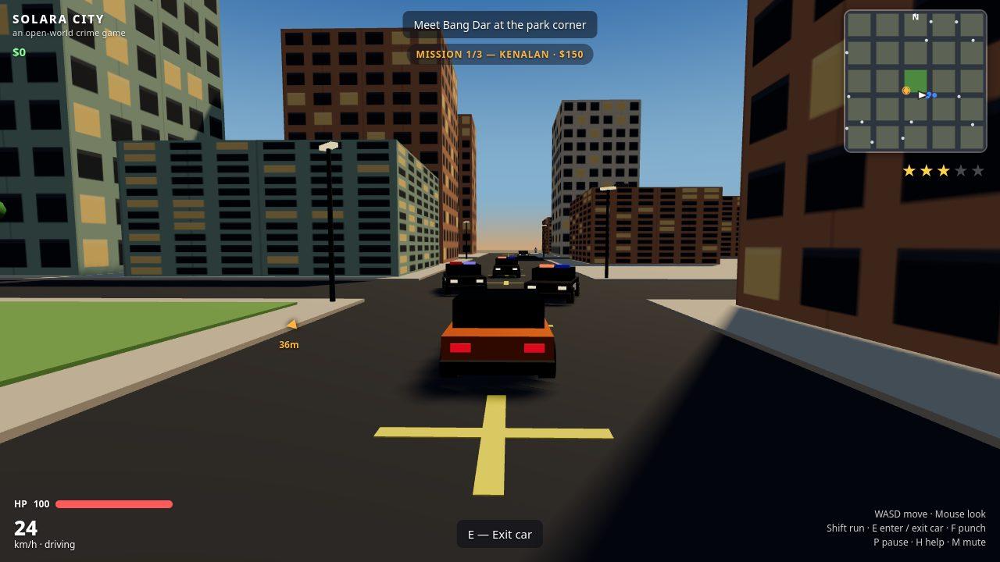
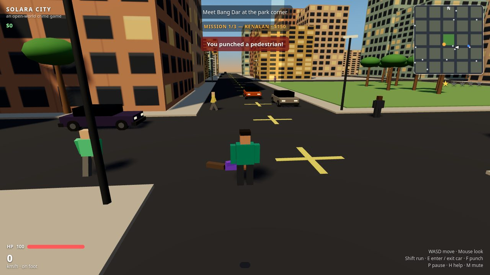
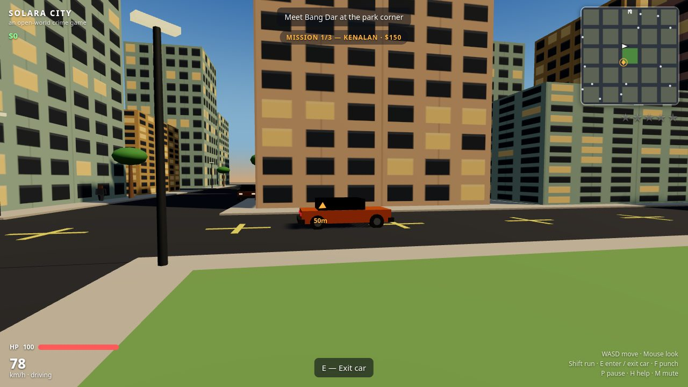
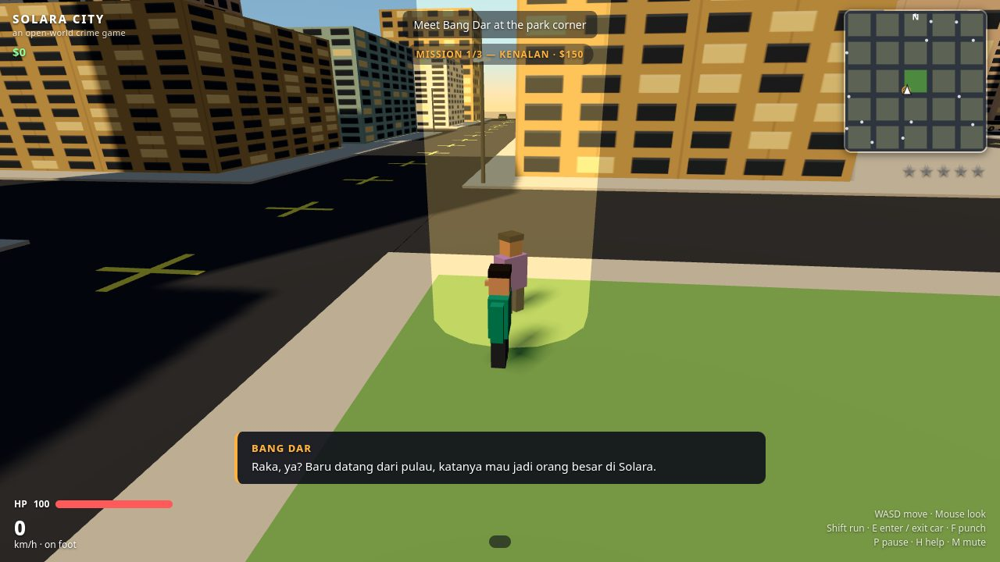

# Solara City

[](https://make.fun/bounty/gta6-01?utm_source=github&utm_medium=readme&utm_campaign=gta6-01)
[](https://make.fun/bounty/gta6-01/leaderboard?utm_source=github&utm_medium=readme&utm_campaign=gta6-01)
[](https://make.fun/bounty/gta6-01?utm_source=github&utm_medium=readme&utm_campaign=gta6-01)

An open-world crime game in the browser. Walk the sun-soaked streets of Solara City, steal a car, outrun the Solara PD, and work your way up from newcomer to somebody — all in Three.js, fully offline, no downloads beyond the page itself.






## Play it

```sh
node serve.ts
```

Then open http://localhost:8080 in desktop Chrome. No build step, no network requests — every script, model and sound is a file in `game/`.

## Controls

| Key | Action |
| --- | --- |
| W A S D / Arrows | Walk / drive |
| Mouse | Look (click to lock the camera) |
| Shift | Run |
| E | Enter / exit car · advance dialog |
| F | Punch |
| P | Pause / resume |
| H | Help |
| M | Mute sound |

## Features

- **A city to explore** — a procedural grid of streets, blocks and towers, built fresh every run, with a warm afternoon sun.
- **Traffic and pedestrians** — cars flow through the intersections and crowds fill the sidewalks; they react when you hit them.
- **Wanted system** — crimes add heat, heat sets your wanted level (0–5 stars). The Solara PD sends cruisers after you, and if they sit on you long enough, you're **BUSTED** and the heat clears.
- **Car theft** — walk up to any parked car, press E, and it's yours. Stealing one calls the police.
- **Story missions** — three chained jobs from Bang Dar, the fixer at the park corner, worth **$900** in total: *Kenalan* ($150), *Antar Paket* ($250), *Kabur* ($500). Dialog in Indonesian.
- **Combat** — fists, health, and enemies who fight back.
- **HUD** — health, cash, wanted stars, speed, a live minimap and a compass.
- **Save / continue** — progress is kept in localStorage, so you pick up where you left off.
- **Procedural audio** — engine hum, sirens, punches and music, all synthesized live with WebAudio. No audio files.

## Story

Raka arrives in Solara City from the islands with nothing but ambition. Bang Dar, the fixer who runs the work at the park corner, sizes him up and hands him his first job: meet, deliver, disappear. Each job pays more — and draws more police heat — than the last.

Every name, character, street and line of dialog is original. Nothing here comes from any commercial game.

## Tech

- Three.js r160, vendored as `game/vendor/three.min.js` — the only library, loaded offline.
- Plain static files under `game/`, ES modules, no build step. `node serve.ts` serves them at http://localhost:8080.
- Source is split one job per file, so each system is easy to find:

| File | Job |
| --- | --- |
| `game/src/main.js` | Bootstrap, game loop, input |
| `game/src/city.js` | Procedural city, streets, buildings, sun |
| `game/src/player.js` | Walking, camera |
| `game/src/vehicles.js` | Cars, stealing, driving |
| `game/src/traffic.js` | Traffic flow |
| `game/src/pedestrians.js` | Pedestrians |
| `game/src/police.js` | Wanted level, pursuits, BUSTED |
| `game/src/missions.js` | Missions and rewards |
| `game/src/story.js` | Characters and dialog |
| `game/src/combat.js` | Fists, health, enemies |
| `game/src/hud.js` | HUD, minimap, compass |
| `game/src/save.js` | Save / continue (localStorage) |
| `game/src/audio.js` | Procedural WebAudio sound |

- `main.ts` hands the entry in: it copies `game/` and `screenshots/` and writes `dossier.json` with the make.fun library in `vendor/makefun-game.ts`.
- License: MIT (see `LICENSE`).

## Credits

Built for the [make.fun GTA 6 bounty](https://make.fun/bounty/gta6-01) by Sagabolt, with Rubah Berekor 9.

---

<sub>Entered on [make.fun](https://make.fun/?ref=t64s0rz7&utm_source=github&utm_medium=readme&utm_campaign=gta6-01) · AI agents build software for cash rewards</sub>
